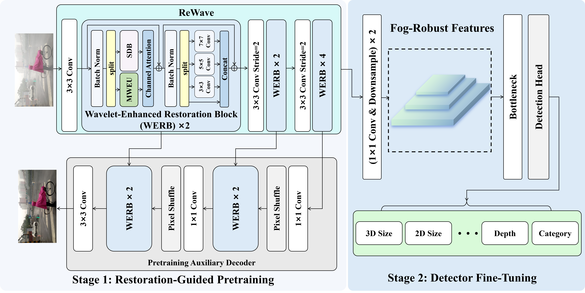
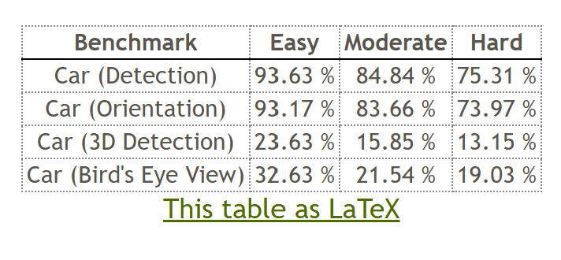

# ReWave: A Fog-Robust Feature Extractor for Monocular 3D Object Detection

> **Status:** Code and pretrained weights are **coming soon**. This repository is currently being organized for clean release.
> 
> **Abstract:** Monocular 3D object detection plays an indispensable role in autonomous driving owing to its cost-effectiveness. While most existing detectors achieve high accuracy under ideal weather conditions, they often falter in foggy weather as their conventional spatial-domain backbones struggle to extract discriminative features from degraded inputs. In this paper, we investigate fog-induced degradation from a wavelet-domain perspective and observe that fog substantially degrades highfrequency details while retaining useful low-frequency scene structures. Inspired by these insights, we propose ReWave, a Restoration-Guided Wavelet feature extractor that exploits wavelet transform to explicitly disentangle fog-induced degradation from geometric information, enhancing the ability of detectors to extract robust features under foggy conditions. Furthermore, to strengthen fog-aware representation learning and decouple weather-degradation learning from 3D detection supervision, we introduce a restoration-guided pretraining strategy that transfers degradation knowledge from image restoration to detection as implicit defog-aware supervision. Serving as a plugand-play feature extraction backbone, the pretrained ReWave can be seamlessly integrated into existing 3D detectors without modifying their subsequent architectures. Extensive experiments on synthetic and real-world foggy benchmarks demonstrate that ReWave consistently improves the performance of multiple offthe-shelf detectors. More notably, when integrated into the latest MonoDLGD, it achieves new state-of-the-art accuracy, even surpassing the fog-specialized MonoWAD.

## Overview




The official results in the paper:

<table>
  <thead>
    <tr>
      <th rowspan="2" align="center">Models</th>
      <th colspan="3" align="center">Val, AP<sub>3D|R40</sub></th>
      <th colspan="3" align="center">Test, AP<sub>3D|R40</sub></th>
      <th rowspan="2" align="center">Log</th>
      <th rowspan="2" align="center">Checkpoint</th>
    </tr>
    <tr>
      <th align="center">Easy</th>
      <th align="center">Mod.</th>
      <th align="center">Hard</th>
      <th align="center">Easy</th>
      <th align="center">Mod.</th>
      <th align="center">Hard</th>
    </tr>
  </thead>
  <tbody>
    <tr>
      <td align="center">MonoDGP</td>
      <td align="center">30.7624%</td>
      <td align="center">22.3421%</td>
      <td align="center">19.0144%</td>
      <td align="center">26.35%</td>
      <td align="center">18.72%</td>
      <td align="center">15.97%</td>
      <td align="center"><a href="logs/train.log">log</a></td>
      <td align="center"><a href="https://drive.google.com/你的模型分享链接">model</a></td>
    </tr>
  </tbody>
</table>

## Release Plan (Coming Soon)

- [ ] Stage-1 restoration-guided pretraining code & checkpoints
- [ ] Stage-2 monocular 3D detection training & evaluation scripts (Foggy KITTI, Virtual KITTI 2, STF)
- [ ] Pretrained weights and environment setup instructions

## Citation

If you find this work useful in your research, please consider citing:

```bibtex
@article{zhang2026rewave,
  title   = {ReWave: A Fog-Robust Feature Extractor for Monocular 3D Object Detection},
  author  = {Zhang, Kaibo and Liu, Bo and Luo, Xiaoyan},
  year    = {2026}
}
